# Architecture & Design Decisions: Local-First CRM Case Classification

> **Author:** Pavan Chavali ([pchavali09](https://github.com/pchavali09))  
> **Status:** Technical Architecture Reference  
> **Target Audience:** Enterprise Software Architects, Principal AI Engineers, CRM Technical Leads

---

## 1. Context: CRM Routing Strategies

Enterprise CRM deployments (Salesforce Service Cloud, ServiceNow, Zendesk) evaluate routing strategies across distinct architectural tiers:

1. **Rule Engines (Heuristics):** Handcrafted regex rules, keyword matchers, and CRM Assignment Rules. While execution is virtually instantaneous (under 0.01 ms), rules are brittle when confronted with novel phrasing or multi-topic inquiries, and provide no calibrated uncertainty measure.
2. **Closed SaaS AI (e.g., Salesforce Einstein Case Classification):** Vendor-managed machine learning models trained on closed historical cases. In our Sandbox benchmark, Einstein achieved 20.00% overall accuracy (40/200) and 27.21% routed accuracy (40/147) when evaluated on the held-out hard test set, routing exclusively to Billing with 53 cases unrouted. Models remain closed inside the vendor cloud platform with limited custom architectural inspectability.
3. **Local Machine Learning Models:** Self-hosted decision systems running within the application perimeter. This benchmark evaluated both the **real Laya foundation model** (`convaiinnovations/laya`, 421M parameter transformer by NandhaKishorM) and a **Simple Local Baseline** (TF-IDF + 2-layer MLP).

---

## 2. Architectural Comparison

```mermaid
flowchart TD
    subgraph Legacy_Rules["1. Heuristic Rules Baseline"]
        R_In["Incoming Case"] --> R_Regex["Keyword Regex Rules"]
        R_Regex -->|Match / Default| R_Out["100% Deterministic Routing<br/>(Confidence: None | No Abstention)"]
    end

    subgraph Einstein_SaaS["2. Salesforce Einstein (Cloud SaaS)"]
        E_In["Incoming Case"] --> E_Cloud["Salesforce Cloud ML Model<br/>(Trained on historical closed cases)"]
        E_Gate{"Confidence Score<br/>Meets Automate Threshold?"}
        E_Cloud --> E_Gate
        E_Gate -->|Above Threshold| E_Auto["Auto-Populate Department<br/>(Automated Routing)"]
        E_Gate -->|Below Threshold| E_Unrouted["Leave Field Blank<br/>(Escalate to Human Agent)"]
    end

    subgraph Local_Engines["3. Local-First ML Systems"]
        L_In["Incoming Case"] --> L_Router["Local Inference Engine"]
        L_Router --> L_Laya["Real Laya Model<br/>(convaiinnovations/laya)"]
        L_Router --> L_TFIDF["Simple Local Baseline<br/>(TF-IDF + Calibrated MLP)"]
        L_TFIDF --> L_Gate{"Confidence Gate<br/>Score ≥ τ?"}
        L_Gate -->|Above Threshold| L_Auto["Auto-Route Case"]
        L_Gate -->|Below Threshold| L_Human["Route to Triage / Review"]
    end
```

---

---

## 3. Evaluated Model Architectures & Measured Behaviors (Option A Setup)

Under **Option A**, all trained baselines and fine-tuned models utilize a single, unified training dataset: `data/einstein_hard_benchmark/train_closed.csv` (800 closed cases, strictly balanced across 20 business themes with 40 cases per theme). This prevents lexical template overlap and guarantees that zero test themes leak into the training distribution. A matching Salesforce import file (`data/einstein_hard_benchmark/train_salesforce_import.csv`) was generated to enable Einstein sandbox retraining.

### A. Real Laya Foundation Model (`convaiinnovations/laya`)
* **Package & Weights**: Pinned to `laya==0.4.13` (English: `convaiinnovations/laya`, 421.3M parameters with `answerdotai/ModernBERT-large` backbone; Multilingual: `convaiinnovations/laya-multilingual`, 321.9M parameters with `jhu-clsp/mmBERT-base` backbone).
* **Zero-Shot Evaluation**:
  * Original Templated 200 Test Set: **56.00%** (112/200) with clean descriptive criteria; **46.50%** (93/200) with choice list criteria.
  * Hard Group-Held-Out 200 Test Set: **46.00%** (92/200) with clean descriptive criteria; **47.00%** (94/200) with choice list criteria.
* **Full Transformer Fine-Tuning (Colab GPU Pipeline)**:
  * Full ModernBERT-large backbone fine-tune with `freeze_encoder=False`, `encoder_lr=2.5e-5`, `head_lr=1e-4`, `micro_batch=4`, `grad_accum=16` (effective batch size 64) across 3 distinct seeds (`[2026, 2027, 2028]`).
  * Checkpoint reloading via canonical `laya.load(out_dir)`, weight divergence assertion against base model snapshot, and evaluation on both test sets (98.7% average on hard test set; 45.5% on transfer).

### B. Simple Local Baseline (TF-IDF + 2-layer MLP)
* **Architecture**: Scikit-Learn `TfidfVectorizer` (5,000 max features, unigram + bigram, English stop words) paired with a PyTorch 2-layer MLP (`input_dim=5000`, `hidden_dim=64`, `ReLU`, `Dropout(0.2)`, `output_dim=5`).
* **Performance (Trained on Narrow 800)**:
  * Hard 200 Test Set: **30.50%** (61/200).
  * Original 200 Test Set: **42.00%** (84/200).
* **Reference Run (Trained on Broader 800)**:
  * Achieved **96.00%** (192/200) on the hard 200-case test set when trained on a broader 800-case distribution.

### C. Keyword Rules Baseline
* **Trained Keyword Rules (`src/rules_trained.py`, frozen commit `ff8b315`)**: Tuned strictly on the 800 closed cases in `data/einstein_hard_benchmark/train_closed.csv` with zero exposure to the test set. Achieves **41.00%** (82/200) on the 200-case hard test set.

### D. Salesforce Einstein Case Classification
* **Environment**: Production Salesforce Sandbox org with Einstein Case Classification enabled.
* **Hard 800 Retrained Model**: Scored in sandbox with Automate Value enabled at 90% threshold (`train_salesforce_import.csv` -> `test_salesforce_import.csv`), routing 147 cases exclusively to `Billing` (40/200 overall accuracy = 20.00%, 53 unrouted; see `EINSTEIN_HARD_RUN_NOTES.md`).

---

## 4. Key Architectural Takeaways

1. **Synthetic Template Overfitting vs. Generalization**: When trained on templated synthetic data, shallow models like TF-IDF score high by memorizing n-gram cues, but collapse to 30.5% when evaluated across held-out thematic distributions.
2. **Protocol Rigor**: Adopting `data/einstein_hard_benchmark/train_closed.csv` as the unified training dataset prevents lexical leakage, providing a clean foundation for full transformer fine-tuning.
3. **Calibrated Confidence Gating**: Across models, thresholding predictions effectively isolates ambiguous edge cases and protects customer-facing routing workflows.

---

## 5. Artifact Identity & Verification

| System | Artifact Loaded / Evaluated | Source Code Reference |
|---|---|---|
| **Real Laya Zero-Shot** | `convaiinnovations/laya` (Hugging Face) | [`src/laya_inference.py`](src/laya_inference.py), [`src/einstein_benchmark/run_dual_benchmark.py`](src/einstein_benchmark/run_dual_benchmark.py) |
| **Real Laya GPU Fine-Tuned** | ModernBERT-large Checkpoints (Colab) | [`notebooks/laya_gpu_full_finetune.ipynb`](notebooks/laya_gpu_full_finetune.ipynb) |
| **TF-IDF Baseline** | Scikit-Learn + PyTorch 2-layer MLP | [`src/local_tfidf_baseline.py`](src/local_tfidf_baseline.py), [`src/einstein_benchmark/generate_all_baseline_predictions.py`](src/einstein_benchmark/generate_all_baseline_predictions.py) |
| **Trained Rules Baseline** | Keyword patterns from Hard 800 | [`src/rules_trained.py`](src/rules_trained.py) (commit `ff8b315`) |
| **Salesforce Einstein** | Production Sandbox Model | [`data/einstein_hard_benchmark/einstein_hard_raw_export.csv`](data/einstein_hard_benchmark/einstein_hard_raw_export.csv) |

