# Architecture & Design Decisions: Local-First CRM Case Classification

> **Author:** Pavan Chavali ([pchavali09](https://github.com/pchavali09))  
> **Status:** Technical Architecture Reference  
> **Target Audience:** Enterprise Software Architects, Principal AI Engineers, CRM Technical Leads

---

## 1. Context: CRM Routing Strategies

Enterprise CRM deployments (Salesforce Service Cloud, ServiceNow, Zendesk) evaluate routing strategies across distinct architectural tiers:

1. **Rule Engines (Heuristics):** Handcrafted regex rules, keyword matchers, and CRM Assignment Rules. While execution is virtually instantaneous (under 0.01 ms), rules are brittle when confronted with novel phrasing or multi-topic inquiries, and provide no calibrated uncertainty measure.
2. **Closed SaaS AI (e.g., Salesforce Einstein Case Classification):** Vendor-managed machine learning models trained on closed historical cases. In our Sandbox benchmark, Einstein achieved 99.42% accuracy among cases routed (172/173), while abstaining on 27 ambiguous cases. However, models remain closed inside the vendor cloud platform with limited custom architectural inspectability.
3. **Local Machine Learning Models:** Self-hosted decision systems running within the application perimeter. This benchmark evaluated both the **real Laya foundation model** (`convaiinnovations/laya`, 421M parameter transformer by NandhaKishorM) and a **Simple Local Baseline** (TF-IDF + 2-layer MLP).

---

## 2. Architectural Comparison

```mermaid
flowchart TD
    subgraph Legacy_Rules["1. Heuristic Rules Baseline"]
        R_In["Incoming Case"] --> R_Regex["Keyword Regex Rules"]
        R_Regex -->|Match / Default| R_Out["100% Deterministic Routing<br/>(Confidence: None | No Abstention)"]
    end

    subgraph Einstein_SaaS["2. Salesforce Einstein (Cloud SaaS)"]
        E_In["Incoming Case"] --> E_Cloud["Salesforce Cloud ML Model<br/>(Trained on 800 closed cases)"]
        E_Cloud --> E_Gate{"Confidence Score<br/>Meets Automate Threshold?"}
        E_Gate -->|Yes: 173 cases| E_Auto["Auto-Populate Department<br/>(99.4% Empirical Accuracy)"]
        E_Gate -->|No: 27 cases| E_Unrouted["Leave Field Blank<br/>(Escalate to Human Agent)"]
    end

    subgraph Local_Engines["3. Local-First ML Systems"]
        L_In["Incoming Case"] --> L_Router["Local Inference Engine"]
        L_Router --> L_Laya["Real Laya Model<br/>(convaiinnovations/laya)"]
        L_Router --> L_TFIDF["Simple Local Baseline<br/>(TF-IDF + Calibrated MLP)"]
        L_TFIDF --> L_Gate{"Confidence Gate<br/>Score ≥ τ?"}
        L_Gate -->|Above Threshold| L_Auto["Auto-Route Case"]
        L_Gate -->|Below Threshold| L_Human["Route to Triage / Review"]
    end
```

---

## 3. Evaluated Model Architectures & Measured Behaviors

### A. Real Laya Foundation Model (`convaiinnovations/laya`)
* **Package & Weights**: Installed via `pip install laya` (v0.4.13), using the official weights from Hugging Face (`convaiinnovations/laya`).
* **Inference API**: Invoked via `laya.Router().predict(state, questions)` with choice questions spanning `['Billing', 'Technical', 'Sales', 'Operations', 'Other']`.
* **Zero-Shot Accuracy**:
  * With choice labels only: **46.50%** top-1 accuracy (93/200).
  * With descriptive category definitions: **56.00%** top-1 accuracy (112/200).
* **Fine-Tuned Accuracy**: Fine-tuning the classification head with `freeze_encoder=True` on the 800 training cases (with held-out calibration on 80 cases) achieved **46.50%** top-1 accuracy. Calibration improved significantly (ECE dropped from 0.1533 to 0.1095), but raw top-1 accuracy did not increase without unfreezing the transformer backbone.
* **Measured Latency**: **~58 ms** per case on an Apple Silicon M2 using the PyTorch MPS backend.

### B. Simple Local Baseline (TF-IDF + 2-layer MLP)
* **Architecture**: Scikit-Learn `TfidfVectorizer` (5,000 max features, unigram + bigram, English stop words) paired with a PyTorch 2-layer MLP (`input_dim=5000`, `hidden_dim=64`, `ReLU`, `Dropout(0.2)`, `output_dim=5`).
* **Performance**: Achieved **98.50%** top-1 accuracy (197/200 correct) on the test set, and **100.0%** accuracy at Einstein's 173-case coverage level.
* **Measured Latency**: **0.04 ms** per case on local CPU.
* **Training Time**: **0.8 seconds** on 800 training cases.

### C. Salesforce Einstein Case Classification
* **Environment**: Production Salesforce Sandbox org with Einstein Case Classification enabled.
* **Performance**: Routed 173 cases with **99.42%** accuracy (172 correct, 1 error), leaving 27 cases unrouted for human agent triage.

---

## 4. Key Architectural Takeaways

1. **Real Laya vs. Einstein**: Real Laya **lost** to Salesforce Einstein. On this 1,000-case enterprise routing benchmark, Einstein's specialized training delivered 99.42% accuracy among routed tickets, whereas Laya reached 48.55% to 63.01% at equivalent coverage.
2. **Real Laya vs. Classical NLP**: Real Laya **lost** to the simple TF-IDF + MLP baseline. For text classification problems with strong domain vocabulary, classical n-gram representations trained directly on closed historical cases significantly outperformed the frozen zero-shot transformer router.
3. **Role of Confidence Gating**: Across all evaluated models, confidence gating effectively isolated difficult edge cases. In Einstein, abstaining on 27 ambiguous cases lifted accuracy from 86.0% overall to 99.42% among routed cases. In the TF-IDF baseline, abstaining on 27 cases lifted accuracy from 98.50% to 100.00%.

---

## 5. Artifact Identity & Verification

| System | Artifact Loaded / Evaluated | Source Code Reference |
|---|---|---|
| **Real Laya** | `convaiinnovations/laya` (Hugging Face) | [`src/laya_inference.py`](file:///Users/pavanchavali/Documents/SFProjects/sf-claude-test/laya-case-routing-poc/src/laya_inference.py), [`src/laya_baseline.py`](file:///Users/pavanchavali/Documents/SFProjects/sf-claude-test/laya-case-routing-poc/src/laya_baseline.py) |
| **TF-IDF Baseline** | Scikit-Learn + PyTorch 2-layer MLP | [`src/local_tfidf_baseline.py`](file:///Users/pavanchavali/Documents/SFProjects/sf-claude-test/laya-case-routing-poc/src/local_tfidf_baseline.py) |
| **Rules Baseline** | Regex keyword patterns | [`src/rules.py`](file:///Users/pavanchavali/Documents/SFProjects/sf-claude-test/laya-case-routing-poc/src/rules.py) |
| **Salesforce Einstein** | Production Sandbox Case Classification Model | [`data/einstein_benchmark/einstein_predictions.csv`](file:///Users/pavanchavali/Documents/SFProjects/sf-claude-test/laya-case-routing-poc/data/einstein_benchmark/einstein_predictions.csv) |
