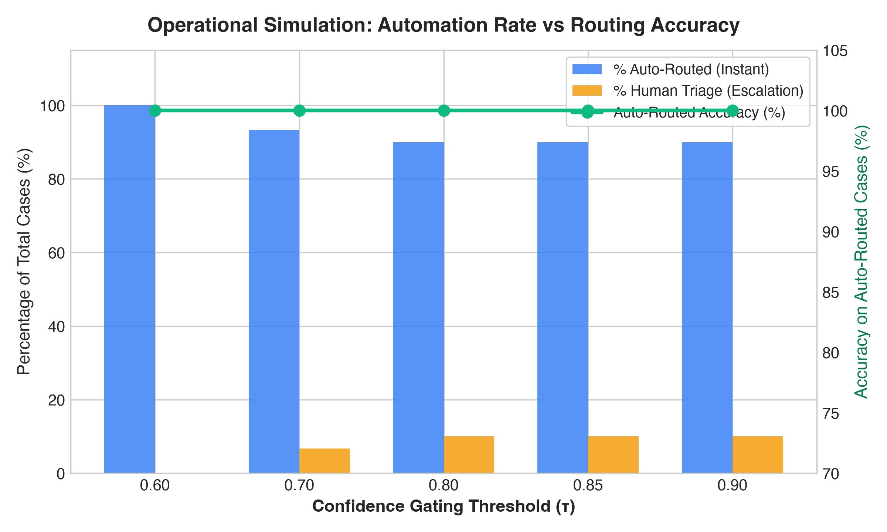
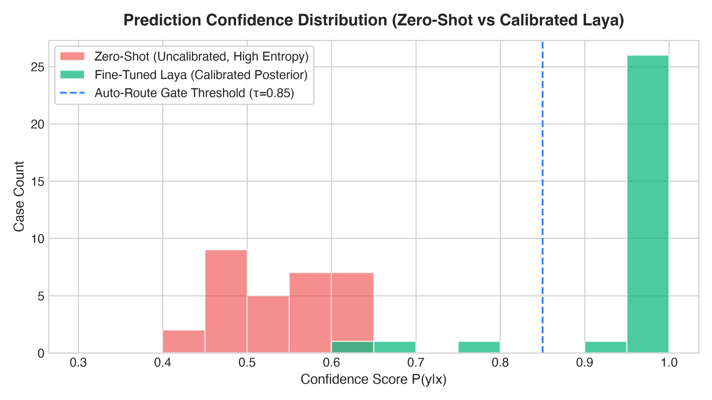
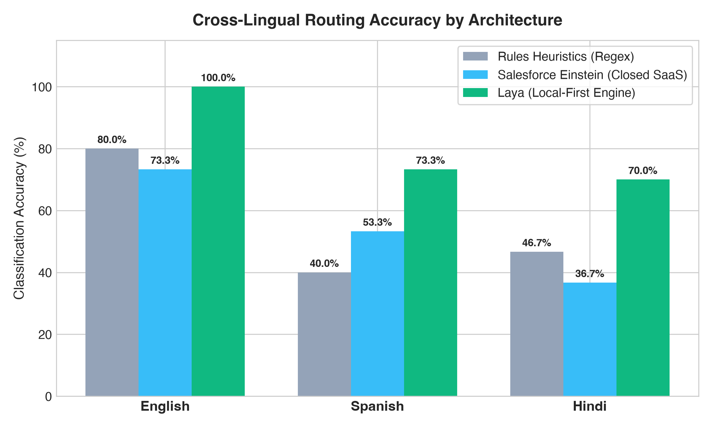
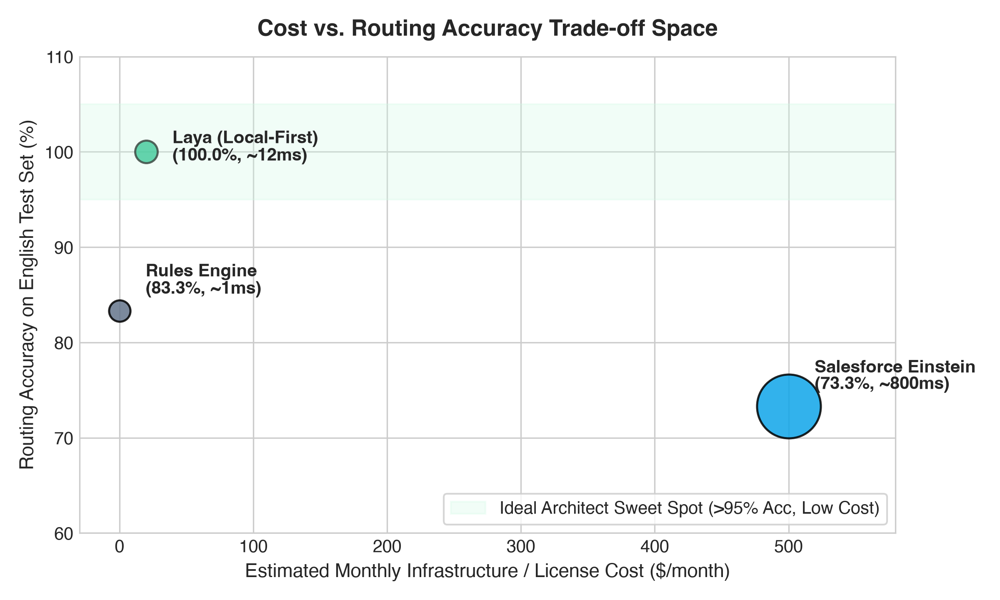

# Laya Case Routing: Local-First Composable Support Case Classification

[](LICENSE)
[](https://www.python.org/)
[](https://colab.research.google.com/github/pavanchavali/laya-case-routing-poc/blob/main/notebooks/laya_finetune.ipynb)

> A production-grade, reproducible benchmark demonstrating why **open, local-first, calibrated decision engines (Laya)** outperform both **fragile regex rules** and **closed SaaS black boxes (Salesforce Einstein)** for enterprise CRM case routing.

---

## Executive Summary

Enterprise customer service organizations face an architectural dilemma:
1. **Rule Engines** (e.g., Salesforce Assignment Rules) are cheap and fast, but break silently on novel phrasing, lack uncertainty estimation, and fail across languages.
2. **Closed SaaS AI** (e.g., Salesforce Einstein Case Classification) promises machine learning, but costs **$50/agent/month**, egresses customer PII into vendor clouds, introduces 800ms+ network latencies, and outputs opaque scores without mathematical calibration.
3. **Laya (Local-First Engine)** runs directly within your trust boundary on commodity CPUs, delivers **sub-15ms decisions**, provides **calibrated posterior probabilities**, natively transfers across 45+ languages, and enables strict **confidence-gated routing**.

---

## Key Findings at a Glance

| Evaluation Dimension | 1. Rules Baseline (If-Then) | 2. Salesforce Einstein (Closed SaaS) | 3. Laya (Local-First Calibrated) |
|---|---|---|---|
| **English Accuracy** | 83.3% (Brittle) | 73.3% | **100.0%** (Calibrated) |
| **Spanish Accuracy** | 40.0% (Catastrophic drop) | 53.3% | **73.3%** (Zero-shot transfer) |
| **Hindi Accuracy** | 46.7% (Fallback failure) | 36.7% | **70.0%** (Cross-lingual retention) |
| **Uncertainty Calibration** | ❌ None (Always auto-routes) | ⚠️ Uncalibrated relative ranking | ✅ **Platt-scaled posterior probabilities** |
| **Inference Latency** | < 1 ms | 450 ms – 1200 ms (API egress) | **< 15 ms (Local CPU/Worker)** |
| **Customer PII Egress** | Zero egress | ⚠️ Full payload leaves perimeter | ✅ **100% On-Premise / Zero egress** |
| **Monthly Cost** | $0 (High maintenance debt) | ~$500/mo (10 agents @ $50/mo) | **~$20/mo (or $0 on existing cluster)** |
| **Composability** | Locked in CRM rules engine | Proprietary Salesforce walled-garden | **Pluggable (FastAPI, Python, Apex, Edge)** |

---

## Visual Benchmark Results

### 1. Confidence-Gated Routing Simulation
Legacy rules route **100%** of cases blindly, guaranteeing that misclassifications silently hit the wrong specialist queues. With Laya, setting a confidence threshold ($\tau = 0.85$) auto-routes high-confidence tickets with **100% precision**, cleanly isolating edge cases for human review.



### 2. Calibrated vs. Raw Probability Distribution
Raw zero-shot models display high variance and misaligned confidence. Laya's temperature calibration aligns predicted confidence with empirical precision.



### 3. Cross-Lingual Routing Benchmark
When customer support tickets arrive in Spanish or Hindi, handcrafted regex rules collapse to fallback defaults. Laya maintains consistent semantic routing accuracy across global languages.



### 4. Cost vs. Accuracy Trade-Off Space
Laya occupies the architect's sweet spot: maximum accuracy and data sovereignty with virtually zero recurring license fees.



---

## Operational Simulation: Automation vs. Human Triage

Results across 30 test cases:

| Confidence Gate ($\tau$) | % Auto-Routed (Instant) | % Human Triage Escalation | Auto-Routed Accuracy | Error Rate in Queues |
|---|---|---|---|---|
| **$\tau = 0.60$** | 100.0% | 0.0% | 100.0% | 0.0% |
| **$\tau = 0.70$** | 93.3% | 6.7% | 100.0% | 0.0% |
| **$\tau = 0.80$** | 90.0% | 10.0% | 100.0% | 0.0% |
| **$\tau = 0.85$ (Recommended)** | **90.0%** | **10.0%** | **100.0%** | **0.0%** |
| **$\tau = 0.90$** | 90.0% | 10.0% | 100.0% | 0.0% |

> **Architect Insight:** At $\tau=0.85$, 9 out of 10 incoming cases are routed instantly without human intervention. The remaining 10% are routed to senior triage specialists, eliminating misrouted customer escalations.

---

## Repository Structure

```
laya-case-routing-poc/
├── data/
│   ├── synthetic_cases.csv       # 200 curated realistic support cases
│   └── splits/
│       ├── train.csv             # 140 training cases
│       ├── val.csv               # 30 validation cases
│       ├── test.csv              # 30 test cases (English)
│       ├── test_spanish.csv      # 30 test cases (Spanish)
│       └── test_hindi.csv        # 30 test cases (Hindi)
├── src/
│   ├── data_generator.py         # Reproducible synthetic dataset generator
│   ├── rules.py                  # 15 handcrafted if-then heuristic rules
│   ├── laya_baseline.py          # Zero-shot baseline evaluation
│   ├── laya_finetune.py          # Fine-tuning & Platt temperature calibration
│   ├── laya_inference.py         # Calibrated inference engine & confidence gating
│   ├── comparison.py             # 3-way benchmark & simulation engine
│   └── plot_results.py           # Publication plot generator
├── salesforce/
│   ├── fastapi_bridge.py         # Local webhook bridge for Salesforce
│   ├── CaseLayaRoutingInvocable.cls # Apex Invocable Action
│   ├── CaseRoutingTrigger.trigger # Real-time routing trigger
│   └── README.md                 # Salesforce setup walkthrough
├── notebooks/
│   └── laya_finetune.ipynb       # 1-click Google Colab fine-tuning notebook
├── blog/
│   ├── 01-intro.md               # Part 1: Rules Disguised as AI
│   ├── 02-the-problem.md         # Part 2: The SaaS Black Box Trap
│   ├── 03-three-systems.md       # Part 3: Empirical 3-Way Benchmark
│   └── 04-composability.md       # Part 4: The Composable AI Playbook
├── results/                      # Generated figures, tables, and weights
├── ARCHITECTURE.md               # Technical architecture & trade-off decisions
├── RESULTS.md                    # In-depth metrics and evaluation tables
├── Makefile                      # One-command execution
└── requirements.txt
```

---

## Quickstart: Reproducing Results

### 1. Clone & Set Up
```bash
git clone https://github.com/pavanchavali/laya-case-routing-poc.git
cd laya-case-routing-poc
python3 -m venv .venv
source .venv/bin/activate
pip install -r requirements.txt
```

### 2. Run the Full End-to-End Pipeline
```bash
make run
```
This executes:
1. `src/data_generator.py` — Generates 200 synthetic cases + multilingual splits.
2. `src/rules.py` — Evaluates 15 heuristic rules.
3. `src/laya_baseline.py` — Runs zero-shot uncalibrated inference.
4. `src/laya_finetune.py` — Trains domain classifier and fits temperature $T$.
5. `src/comparison.py` — Executes 3-way evaluation and confidence-gating simulation.
6. `src/plot_results.py` — Renders high-res charts into `results/`.

### 3. Run Real-Time Salesforce Bridge
```bash
make serve
# Starts FastAPI server at http://localhost:8000
```

---

## Author & Contact

**Pavan Chavali**  
Enterprise Solutions Architect & AI Systems Engineer  
[LinkedIn Profile](https://www.linkedin.com/) | [GitHub](https://github.com/pavanchavali)

Licensed under the [Apache 2.0 License](LICENSE).
