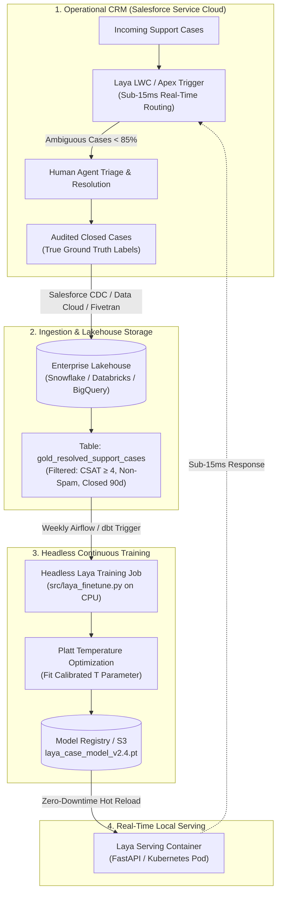

# The Architect’s Blueprint: Composable, Local-First Decision Engines

*By Pavan Chavali · 8 min read*

---

Why does "composability" matter so much in modern AI architecture?

When you adopt closed CRM AI features, you lock your business logic into a single vendor's proprietary lifecycle. If you want to use the same case classification model to triage incoming customer emails before they even hit Salesforce, or route Slack inquiries in your internal IT channels, or classify tickets in Zendesk during a merger or acquisition, you cannot. You are trapped within that vendor’s walled garden.

A **composable architecture** decouples the decision engine from the presentation and storage layer:

```
[Customer Channels] ---> [API Gateway / Event Stream]
                               |
                               v
                     [Laya Decision Engine]
                     (Sub-15ms Local Container)
                               |
               +---------------+---------------+
               |                               |
               v                               v
    [Salesforce Service Cloud]       [Slack IT Dispatcher]
```

### The Three Hallmarks of Composable AI

1. **Protocol Independence:** Laya packages as a clean Python library, a CLI tool, or a lightweight FastAPI container. In this POC repo, we provide an Apex Invocable Action (`CaseLayaRoutingInvocable.cls`) and an Apex Trigger that allow Salesforce to invoke Laya with standard HTTP callouts or Named Credentials in sub-15ms.
2. **Deterministic Ownership:** You own the training weights, the calibration parameters, the evaluation pipelines, and the raw embeddings. There are no surprise deprecations, sudden price hikes, or opaque model updates that silently alter your routing logic overnight.
3. **Hardware Efficiency:** Modern "System 1" decision engines do not require massive GPU clusters. Laya runs happily on commodity CPU cores, consuming less than 150MB of RAM and executing inference in under 15 milliseconds.

---

## The Enterprise Blueprint: Continuous Learning via Data Lakehouse

In an enterprise deployment, how does the system continuously learn as agents resolve more cases? 

You do **not** run an interactive Jupyter notebook manually. Instead, the training logic in `src/laya_finetune.py` executes as a **headless scheduled job**, reading clean training records directly from your **Enterprise Data Lakehouse (Snowflake, Databricks, BigQuery, or AWS S3 Iceberg)**:



### Why Decoupling Through the Lakehouse is Critical:
* **Zero Performance Impact on Salesforce:** Training queries read from Snowflake/Databricks, completely avoiding Salesforce API limits, SOQL row caps, and transaction locks.
* **Gold-Layer Data Hygiene:** The Lakehouse pipeline applies strict data quality filters (e.g. only training on tickets with high customer satisfaction scores, filtering out spam or duplicate tickets).
* **Context Enrichment:** The Lakehouse can join the support case with customer ARR, contract tier, and product telemetry before training, allowing Laya to understand VIP customer routing nuances.
* **Autonomous Confidence Growth:** As Laya learns from thousands of real resolved cases, tickets that were previously borderline (e.g. 74% confidence) climb into high-certainty zones (>85%), automatically expanding the volume of instant auto-routed tickets while keeping misrouting rates near zero.

---

## Conclusion & Getting Started

Enterprise AI does not require paying exorbitant SaaS license premiums or surrendering customer privacy to vendor black boxes. By embracing local-first, calibrated decision engines, architects can achieve higher accuracy, faster response times, and bulletproof operational reliability.

You can clone the complete POC repository, inspect every line of code, and reproduce the empirical results on your own machine:

👉 **GitHub Repository:** [github.com/pavanchavali/laya-case-routing-poc](https://github.com/pavanchavali/laya-case-routing-poc)  
👉 **Interactive Colab Notebook:** [Open in Google Colab](https://colab.research.google.com/github/pavanchavali/laya-case-routing-poc/blob/main/notebooks/laya_finetune.ipynb)
